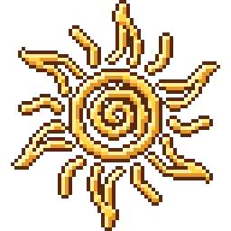
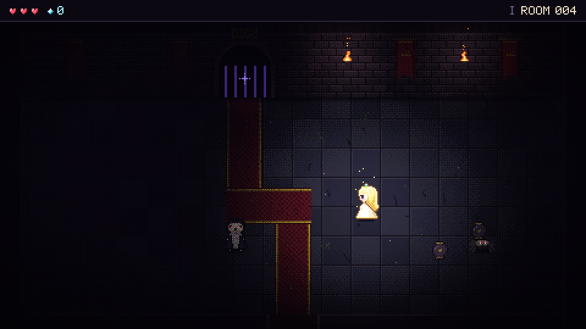
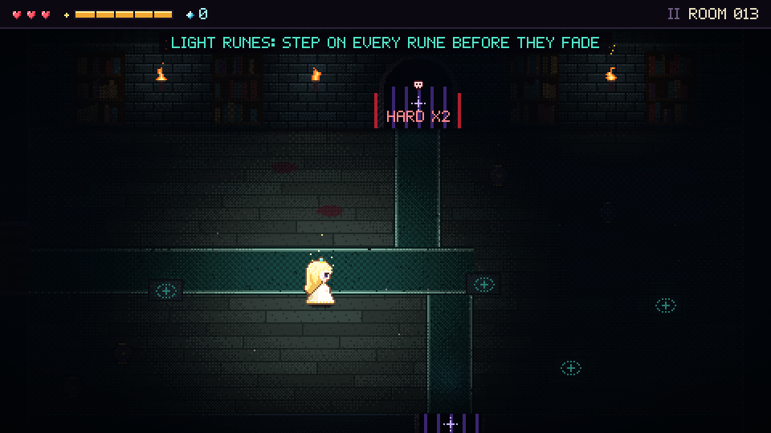
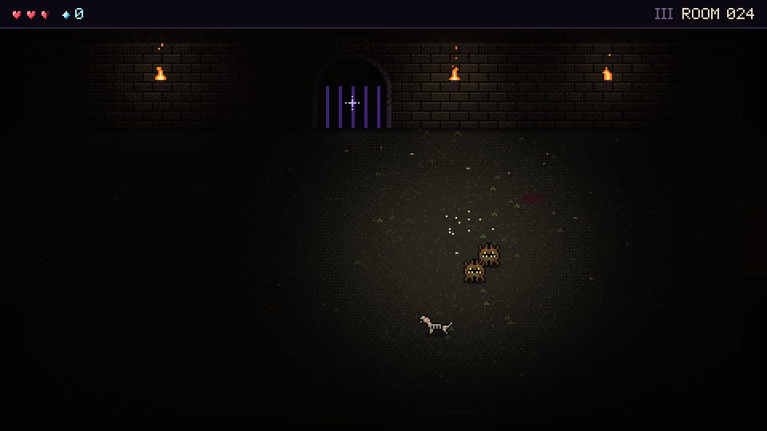
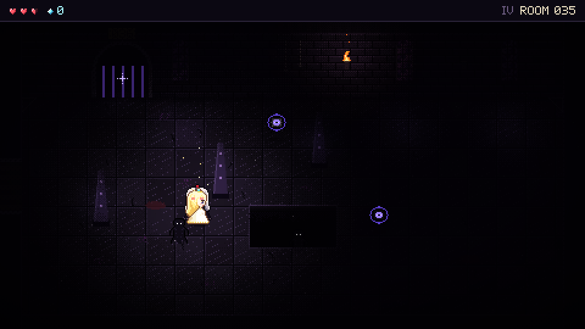

<div align="center">



# Hollowcrown

**A dark pixel-art roguelite where you are the only light left in a castle that forgot the sun.**
One door at a time, every room different. Four wings, twelve monsters, four bosses, and a soundtrack that changes with every wing.

**▶ Play it in your browser:** [lexito-gamerito.itch.io/hollowcrown](https://lexito-gamerito.itch.io/hollowcrown)


</div>

---

## Screenshots
| The Gilded Halls | The Drowned Library |
|:---:|:---:|
|  |  |
| **The Bone Garden** | **The Sunless Spire** |
|  |  |

---

## How it plays
- **One door, a new room every time.** Like Spooky's Jump Scare Mansion, each room has a single way forward, but the room behind it is generated as you walk in. The exit can be on any wall, and there's no way back.
- **Room types:** combat, ambush (most torches out), light-rune and memory-rune puzzles, blessing altars, shrines, and a boss every 10 rooms. Furniture, pits, water and layouts change from room to room.
- **Your light is your life.** Every hit costs half a heart, and as your hearts drain, your glow shrinks and the dark (and what lives in it) closes in. Motes heal half a heart, and shrines heal a full one.
- **Slash enemy orbs** to send them back.
- **A green door.** Most runs never see one.
- **Between runs:** shards are kept when you die, and you spend them at the **Altar of Dawn** on permanent upgrades. Every death also offers a **gift** for your next run. If you keep dying, the gift doubles.

### Wings and monsters
| Wing | Monsters | Boss |
|---|---|---|
| **I. The Gilded Halls** | **Skitter** lunges · **Hollow Doll** freezes in your light and rushes you in the dark · **Gilded Sentinel** slams shockwaves, then has to recover | **The Hollow King** |
| **II. The Drowned Library** | **Leaflings** flutter in flocks · **Ink Lurker** hides as a puddle · **Weeper** hurls ink from afar | **The Archivist** |
| **III. The Bone Garden** | **Bone Hound** circles and bites · **Rootling** burrows under you · **Thorn Bloom** spits thorns in every direction | **The Gardener** |
| **IV. The Sunless Spire** | **Shade** is invisible outside your light · **Eclipse Eye** stares, then fires a beam · **The Hollow Self** is your reflection | **The Hollow Crown** |

Beat the Hollow Crown to see the ending, then keep going into an endless, harder castle.

### Controls
| Action | Keyboard | Gamepad |
|---|---|---|
| Move | **WASD** / Arrow keys | Left stick / D-pad |
| Slash | **J** or Z | X / Square |
| Dash | **K**, X, Space or Shift | A / Cross, RB |
| Use, pray, take a blessing | **E** | Y / Triangle |
| Pause | **Esc** or P | Start |

---

## 🛠️ Tech Stack
- **HTML5 Canvas & vanilla JavaScript.** No frameworks, no build step, no dependencies.
- **Hand-made pixel art as code.** Every sprite is a text pixel map compiled to canvases at startup (`src/art/`).
- **Dithered lighting.** A per-pixel pass with ordered (Bayer) dithering turns light falloff into crunchy pixel-art bands (`src/engine/light.js`).
- **Procedural rooms.** A seeded RNG builds each room's doors, layout, furniture, monsters and puzzles. A flood fill guarantees every exit is reachable (`src/game/rooms.js`).
- **Synthesized music and sound.** A small chiptune sequencer plays an original song for each wing, the title, the bosses and one other room. Songs are written as text patterns and every note and effect is generated live with the Web Audio API. There are no audio files.
- **`localStorage`** for shards, upgrades, gifts, keys and records.

### Project structure
```
hollowcrown/
├── index.html          # Entry point
├── src/
│   ├── engine/         # Core helpers, input, font, audio, music, lighting, sprite compiler
│   ├── art/            # Princess, monsters & bosses, sun emblem, room painter
│   ├── game/           # Player, enemies, room generation, run logic, menus
│   └── main.js         # Boot + fixed-step game loop
├── assets/             # Icons
├── docs/               # README media
└── tools/              # Sprite sheet viewer, store art generator, music preview page
```

### Run locally
```bash
git clone https://github.com/alex-gamero/hollowcrown.git
cd hollowcrown
# double-click index.html, or serve it:
python -m http.server 8000
# open http://localhost:8000
```
For testing, `?seed=123&room=20` jumps to a room, `&entry=E` picks the entry wall, `&greendoor` adds the green door, `&secret` opens the room behind it, and `&debug` shows FPS.

---

## Coming Soon
- A use for the green keys
- More room types: traps, mimics, shops
- Relics with active abilities
- An original soundtrack
