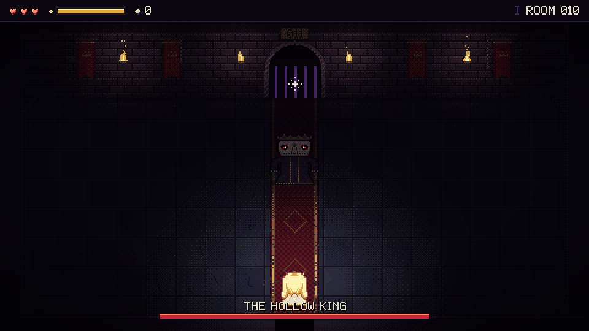
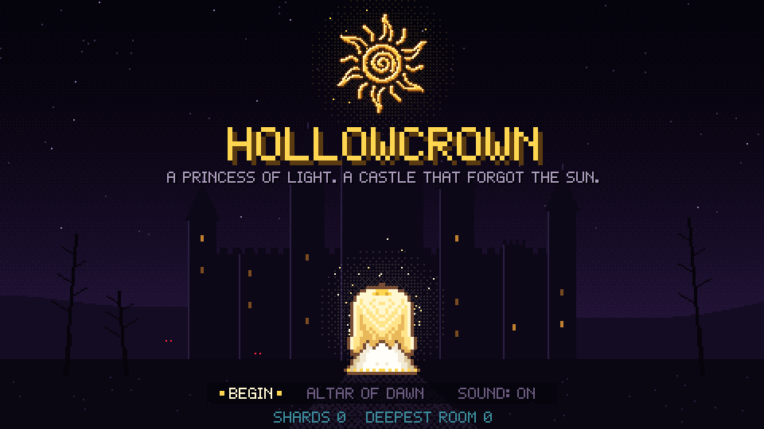
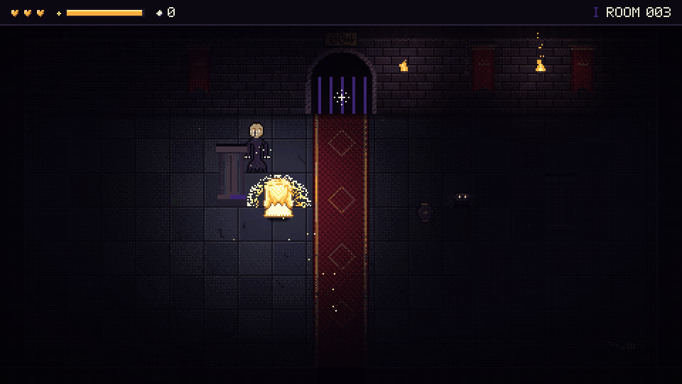
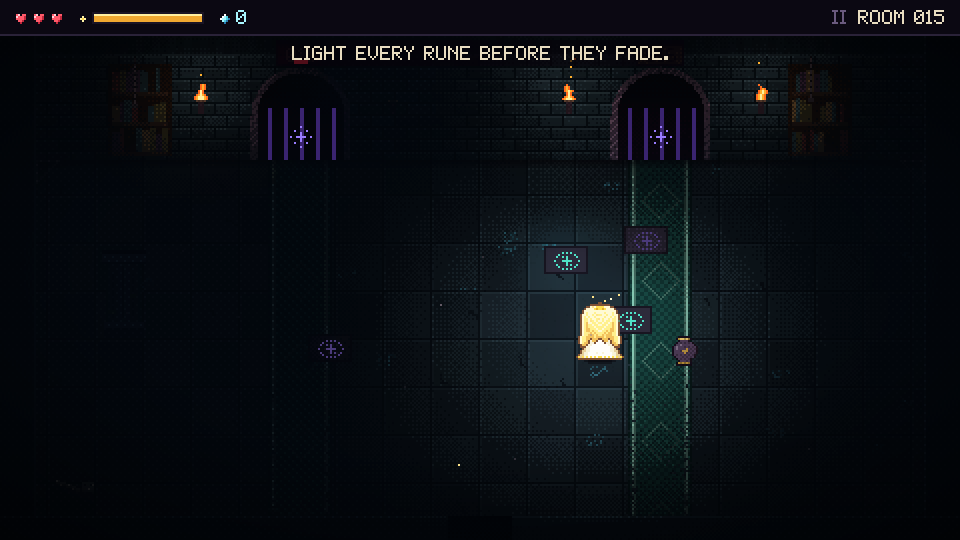
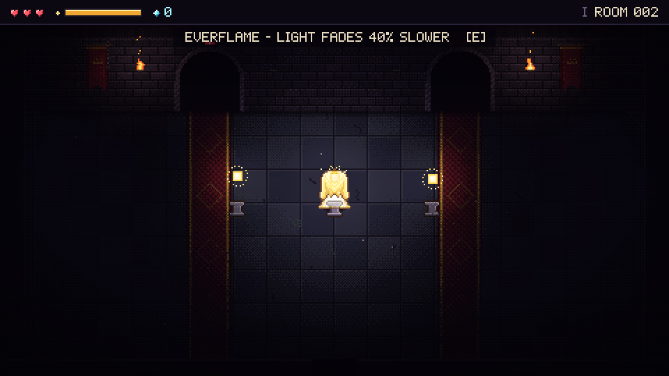
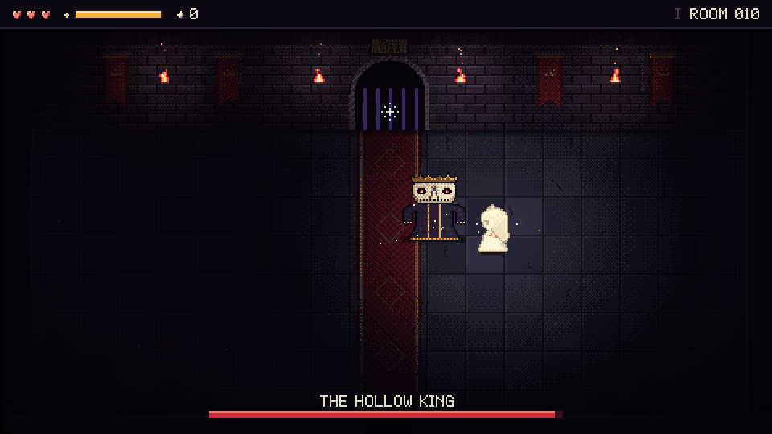

<div align="center">


# Hollowcrown

**A dark pixel-art roguelite where you are the only light left in a castle that forgot the sun.**
Push deeper one door at a time, solve rune puzzles, and survive the things that only move in the dark.




</div>

---

## Screenshots
| Title | A Hollow in the dark |
|:---:|:---:|
|  |  |
| **Rune puzzle in the Drowned Library** | **Choosing a blessing** |
|  |  |
| **The Hollow King** | |
|  | |

---

## How it plays
- **You are the light.** Your glow holds the dark back, and it slowly fades. Monsters drop motes of light, and shrines refill it.
- **Every door is a new room.** Rooms are generated as you walk through them, so no two runs are the same. When there are two doors, the one under a **red eye** is harder and pays more.
- **Room types:** combat, ambushes with the torches out, rune puzzles, blessing altars, shrines with lore, and a boss every 10 rooms.
- **Wings:** The Gilded Halls → The Drowned Library → The Bone Garden.
- **Death isn't the end.** Shards you gather are kept between runs. Spend them at the **Altar of Dawn** on permanent upgrades.

### Monsters
| | |
|---|---|
| **The Hollow** | Freezes while your light is on it. Rushes you the moment it's in darkness. |
| **The Skitter** | Waits, then lunges. |
| **The Lament** | Floats out of reach and weeps orbs of darkness. |
| **The Hollow King** | Rings of orbs, summons, and charges. He remembers the crown. |

### Controls
| Action | Keyboard | Gamepad |
|---|---|---|
| Move | **WASD** / Arrow keys | Left stick / D-pad |
| Slash | **J** or Z | X / Square |
| Dash | **K**, X, Space or Shift | A / Cross, RB |
| Use, pray, take a blessing | **E** | Y / Triangle |
| Pause | **Esc** or P | Start |

---

## 🛠️ Tech Stack
- **HTML5 Canvas & vanilla JavaScript.** No frameworks, no build step, no dependencies.
- **Hand-made pixel art as code.** Every sprite is a text pixel map compiled to canvases at startup (`src/art/`).
- **Dithered lighting.** A per-pixel pass with ordered (Bayer) dithering turns light falloff into crunchy pixel-art bands (`src/engine/light.js`).
- **Procedural rooms.** A seeded RNG builds each room's layout, props, monsters and puzzles (`src/game/rooms.js`).
- **Synthesized sound.** Every effect and the ambient drone are generated live with the Web Audio API. There are no audio files.
- **`localStorage`** for shards, upgrades and records.

### Project structure
```
hollowcrown/
├── index.html          # Entry point
├── src/
│   ├── engine/         # Core helpers, input, font, audio, lighting, sprite compiler
│   ├── art/            # Characters, sun emblem, procedural room painter
│   ├── game/           # Player, enemies, room generation, run logic, menus
│   └── main.js         # Boot + fixed-step game loop
├── assets/             # Icons
├── docs/               # README media
└── tools/sheet.html    # Sprite sheet viewer for art review
```

### Run locally
```bash
git clone https://github.com/alex-gamero/hollowcrown.git
cd hollowcrown
# double-click index.html, or serve it:
python -m http.server 8000
# open http://localhost:8000
```
Use `?seed=123&room=10` in the URL to jump to a specific seed and room, and add `&debug` to show FPS.

---

## Coming Soon
- Unique bosses for the Drowned Library and the Bone Garden
- More monsters and room types (traps, secret rooms, mimics)
- Relics with active abilities
- An original soundtrack
- A playable web build on itch.io
